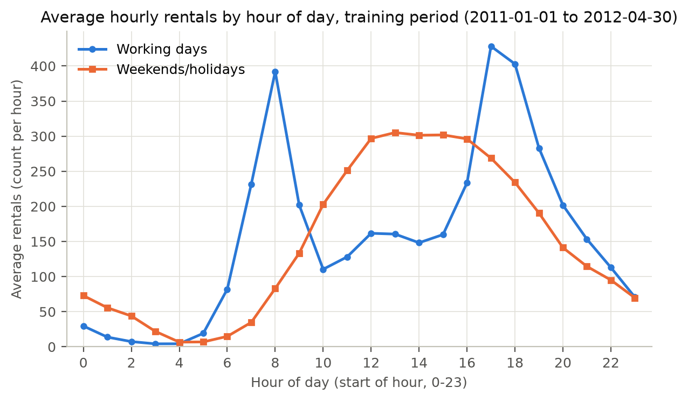
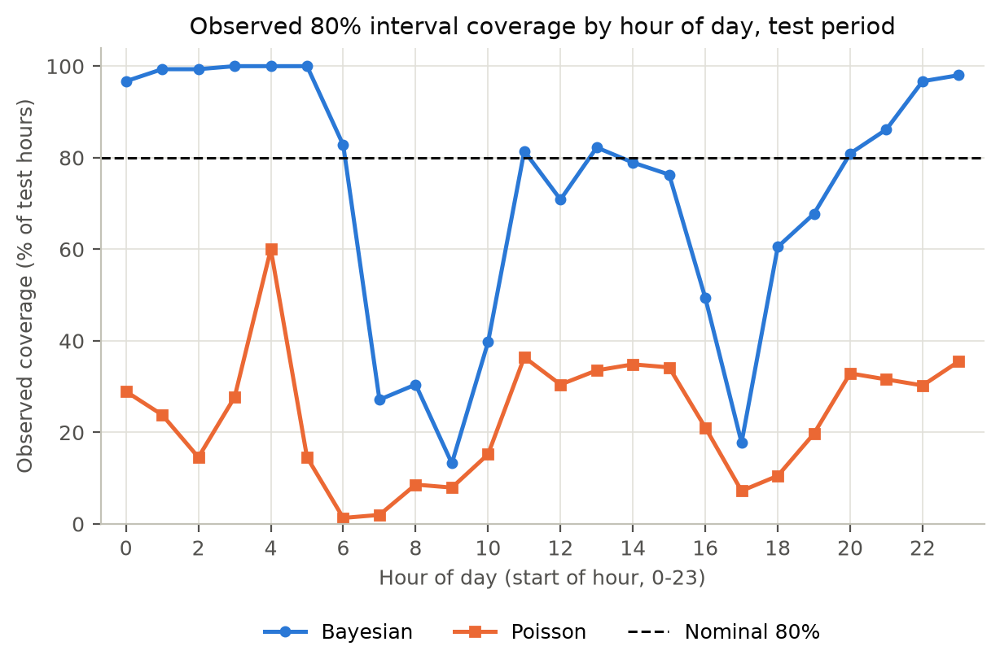
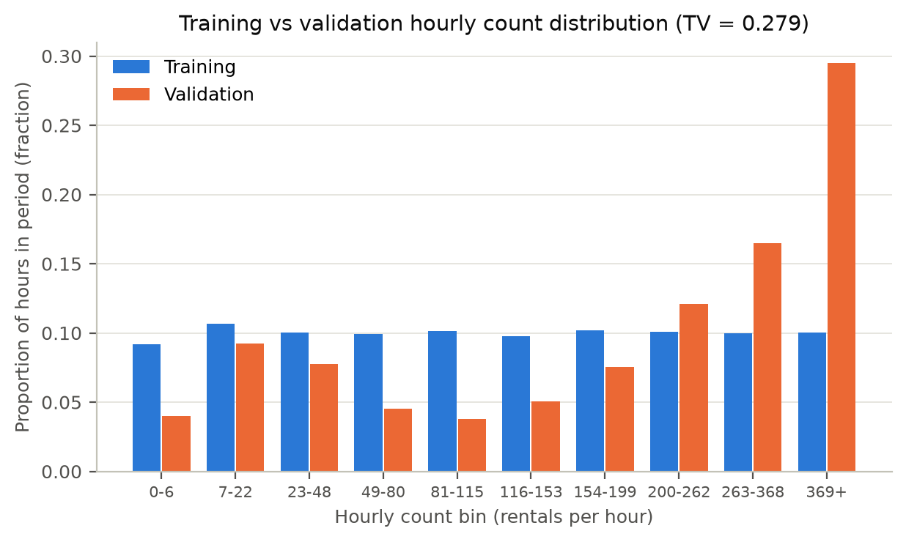

> **DRAFT.** Numbers are taken from the saved results in `outputs/` and `config.json`. The team must review, rewrite in its own words where needed, and fill the TODO items before submission.

# 1. Application and design

## 1.1 Task and user

An operations analyst wants to anticipate busy hours and judge which forecasts can be relied on. The dashboard replays historical forecasts: the analyst picks an hour from the final-test period (1 Aug - 31 Dec 2012), obtains the forecast that could have been issued at the start of that hour, and only then reveals the recorded total `cnt`. The target is the system-wide number of rentals during one hour; no station-level allocation is attempted.

## 1.2 Screens

| Screen | What the analyst does and sees |
|---|---|
| **Data overview** | Date-range selector; observed / missing / excluded hour counts; hourly `cnt` series with gaps preserved; average rentals by hour and working-day status with group sizes; source rows; audit download; *Count distribution* tab (training vs validation histogram and TV). |
| **Forecast one hour** | Test date, observed hour and model selectors; *Forecast* button; point forecast, 80%/95% intervals (or "unavailable"), Bayesian variance decomposition; *Inputs used* table with values, source times, missing flags and replacements; agreement with the saved prediction; separate *Reveal recorded count* button with signed and absolute error. Changing the hour or model clears the forecast and reveal. |
| **Compare models** | Validation-selection summary; full-test MAE / RMSE / hours / training time with the default marked; Poisson probability score; actual-vs-forecast plot for a selected model and test date range; CSV downloads. |
| **Inspect model behaviour** | Tabs: Regularisation (Lasso), History experiment, Interval coverage, Largest errors (row opens the hour's details), Residuals by hour. |

## 1.3 Code organisation

| Module | Responsibility | Key interface |
|---|---|---|
| `data.py` | Read `hour.csv`, build timestamps, audit duplicates/invalid rows/missing hours, assign periods | `audit(raw) -> AuditResult(clean, missing_hours, excluded, audit_table)` |
| `features.py` | Calendar and historical inputs by exact timestamp lookup; `Preprocessor` (training medians, one-hot, scaling) | `build_raw_features(clean, targets) -> DataFrame`; `Preprocessor.fit / transform / save / load` |
| `models.py` | The five methods; intervals; scores | `predict_dist(raw, X) -> {raw_mean, point, lo80, hi80, lo95, hi95, noise_var, coef_var, total_var}` |
| `train_evaluate.py` | Fit on training, select on validation, freeze, replay validation/test, write all results | `fit_select(clean)`; `main()` |
| `app.py` | The four screens; loads saved objects, never refits | - |
| `checks/` | 32 executable checks (pytest) | - |

Input construction never receives the target outcome: `build_raw_features` reads only the target's calendar fields and rows at earlier timestamps; the recorded `cnt` is attached afterwards for scoring (`train_evaluate.py`) or on *Reveal* (`app.py`).

## 1.4 Two design choices against alternatives

1. **Exact timestamp lookup instead of row shifting.** `df.shift(1)` is simpler but, when 05:00 is absent, gives the 04:00 count as "previous hour" for 06:00. We look up $t - 1\,\mathrm{h}$ in the time index, so an absent hour becomes a flagged missing input. Cost: a slightly slower builder for single hours (the training script uses a vectorised equivalent that a check proves identical).
2. **The app rebuilds inputs and re-applies the saved model, rather than displaying stored predictions.** Reading `predictions.csv` would be simpler, but it would not demonstrate that the deployed path (input builder + saved preprocessing + saved model) works. We rebuild and then compare with the saved value; the Forecast screen shows the difference (about 2e-7 rentals for 2012-08-01 08:00, within the 1e-6 tolerance).

## 1.5 Worked replay: 2012-08-01 08:00, default model (Bayesian linear regression)

Calendar inputs: hour 8, Wednesday (weekday 3), month 8, holiday 0, workingday 1.

| Input | Value | Source |
|---|---|---|
| Count one hour earlier | 487 | 2012-08-01 07:00 |
| Count 24 hours earlier | 760 | 2012-07-31 08:00 |
| Count 168 hours earlier | 788 | 2012-07-25 08:00 |
| Mean of previous 24 counts | 300.4167 | 2012-07-31 08:00 to 2012-08-01 07:00 |
| Previous-hour temp / hum / windspeed | 0.64 / 0.83 / 0.1343 | 2012-08-01 07:00 |

No input was missing. Forecast: **664.4** rentals; 80% interval [602.1, 726.7]; 95% interval [569.1, 759.7]. After *Reveal*: recorded **681**, signed error +16.6, absolute error 16.6; both intervals cover the outcome. The 681 is not used for this forecast; it becomes the previous-hour input for 09:00. For comparison the seasonal baseline gives 392.0 (working-day 08:00 training mean) and Poisson 1018.4.

# 2. Data and modelling

## 2.1 Audit findings

`hour.csv` has 17,379 rows, no duplicate timestamps and no invalid counts. Compared with a complete hourly calendar (17,544 hours), **165 hours are absent**: 125 in training, 0 in validation, 40 in test. The test gap includes 36 consecutive hours from 2012-10-29 01:00 to 2012-10-30 12:00; the others are isolated early-morning hours. No observed hour has `cnt = 0`. Absent hours are not scored and are never converted to zero; when an absent hour is a source for a lag, that input is missing.

{width=100%}

## 2.2 Periods

| Period | Dates (inclusive) | Observed target hours |
|---|---|---|
| Training | 2011-01-01 - 2012-04-30 | 11,539 |
| Validation | 2012-05-01 - 2012-07-31 | 2,208 |
| Final test | 2012-08-01 - 2012-12-31 | 3,632 |

Learned parameters (medians, encodings, scaling, coefficients, posterior, selected settings, default) are fixed after training/validation. History, however, advances during replay: forecasting 09:00 uses the recorded 08:00 count, without changing any coefficient.

## 2.3 Inputs and preprocessing

Calendar: hour (24), weekday (7, dataset convention Sunday = 0), month (12) one-hot; holiday and workingday binary. History: counts at $t-1$, $t-24$, $t-168$ h; mean of the 24 counts $t-24, \dots, t-1$ (missing unless all 24 exist); temp, hum, windspeed at $t-1$ (normalised dataset units). Each of these seven has a missing flag.

All fitted on training only: medians (previous-hour count 117, previous-day 117, previous-week 116, 24-hour mean 171.04, temp 0.44, hum 0.62, windspeed 0.194); standardisation (mean/sd after imputation); category lists. Unseen categories map to an all-zero block; a constant column would be centred only. Result: 59 columns. `checks/test_frozen.py` reruns fitting with random test-period values and confirms identical preprocessing.

## 2.4 Model definitions and selected settings

| Method | Definition | Candidates | Selected | Validation MAE |
|-------------|-----------------------------|------------------------------|----------------|------------|
| Seasonal baseline | training mean of `cnt` per (hour, workingday); fallback overall mean | - | lookup | 123.88 |
| Ridge | $b + x^\top w$, L2 penalty, clipped at 0 | $\alpha \in \{0.001, 0.01, \dots, 1000\}$ | 0.001 | 50.228 |
| Lasso | $b + x^\top w$, L1 penalty, clipped at 0 | 10 values 0.001 - 30 | 0.001 | 50.231 |
| Poisson | $\mu = \exp(b + x^\top w)$, L2 penalty | 1e-7 - 0.1 | 1e-7 | 83.96 |
| Bayesian linear | $\beta \sim \mathcal{N}(0, \alpha^{-1} I)$, $y \sim \mathcal{N}(\Phi\beta, \sigma^2 I)$ | $\alpha \in \{\text{1e-8}, \dots, 1\}$; $\sigma^2$ by training fixed point | $\alpha = \text{1e-8}$, $\sigma^2 = 2349.1$ | 50.228 |

For the Bayesian model, $\sigma^2$ is estimated on training data by alternating between the posterior mean and the mean squared training residual until convergence. Posterior: $A = \alpha I + \Phi^\top \Phi / \sigma^2$, $m$ solves $A m = \Phi^\top y / \sigma^2$, $S$ solves $A S = I$.

Ridge, Lasso and Bayesian validation MAE decrease monotonically as the penalty/prior precision decreases and flatten at the bottom of the grid (Ridge 50.2283 at 0.001 and 50.2284 at 0.01). With 11,539 training hours and 59 columns, little regularisation is needed for prediction.

**Default.** Lowest validation MAE: Bayesian 50.22829, Ridge 50.22830 (practically identical; with a near-flat prior the posterior mean approximates the least-squares fit). The tie rule was not needed. The default was frozen in `config.json` before test scoring.

## 2.5 One Bayesian predictive calculation (actual input)

For 2012-08-01 08:00 (section 1.5): $\mu_* = \phi^\top m = 664.378$; observation-noise variance $\sigma^2 = 2349.121$; coefficient-uncertainty variance $\phi^\top S \phi = 15.897$; total $v_* = 2365.018$ (sd 48.63). 80% interval $664.378 \pm 1.28155 \times 48.63 = [602.05, 726.70]$. Almost all predictive uncertainty is observation noise: with 11,539 training hours the coefficients are well determined.

# 3. Results

## 3.1 Five-model point errors (final test, 3,632 hours)

| Model | MAE | RMSE | Validation MAE | Training time (s) |
|---|---|---|---|---|
| Seasonal baseline | 115.82 | 162.58 | 123.88 | 0.003 |
| Ridge | 48.955 | 73.415 | 50.228 | 0.020 |
| Lasso | 48.961 | 73.419 | 50.231 | 0.148 |
| Poisson | 86.63 | 174.70 | 83.96 | 0.281 |
| **Bayesian (default)** | **48.955** | **73.415** | 50.228 | 0.025 |

The three linear-Gaussian models reduce MAE by about 58% relative to the baseline. Their test ranking matches validation, but the differences among them (< 0.01 rentals) are negligible; validation selection should not be read as evidence that Bayesian regression forecasts better than Ridge. RMSE/MAE is about 1.5 for these models, indicating occasional large errors (section 3.7). Poisson has the worst RMSE (174.7), worse even than the baseline, because of very large overpredictions at evening peaks.

{width=100%}

## 3.2 Poisson probability score

Mean negative log probability of the recorded count under $\mathrm{Poisson}(\mu)$: **25.71 nats** over 3,632 test hours. If the outcomes really followed $\mathrm{Poisson}(\mu)$ with the fitted means, the expected score would be the average Poisson entropy, 3.89 nats. The large value reflects both mean errors and a variance ($= \mu$) far too small for the observed variation.

## 3.3 Interval coverage and width (test)

| Model | Nominal | Observed coverage | Mean width |
|---|---|---|---|
| Bayesian | 80% | 72.3% | 124.6 |
| Bayesian | 95% | 83.6% | 190.5 |
| Poisson | 80% | 23.5% | 37.5 |
| Poisson | 95% | 34.8% | 57.3 |

Both models undercover. Bayesian intervals have nearly constant width (noise variance dominates), while the errors are strongly heteroscedastic: by hour, 80% coverage is 100% at 03:00 (counts near zero, interval far too wide) and only 13.2% at 09:00. Coverage is similar on working days (72.9%) and other days (71.0%). Because the Gaussian approximation ignores that counts are non-negative, about 30% of test hours have a negative lower 95% endpoint (kept as saved).

Poisson intervals are much narrower (variance $= \mu$) and miss most outcomes: hourly counts are strongly overdispersed relative to Poisson, and the mean itself is biased at peaks. Coverage is worst at commuting hours (80%: 1.3% at 06:00).

{width=100%}

## 3.4 Lasso regularisation

| $\alpha$ | 0.001 | 0.01 | 0.1 | 0.3 | 1 | 3 | 10 | 30 |
|--------------|-----|-----|-----|-----|-----|-----|-----|-----|
| Validation MAE | 50.23 | 50.26 | 50.73 | 52.03 | 54.62 | 55.75 | 57.34 | 69.33 |
| Non-zero coefficients (of 59) | 54 | 52 | 42 | 32 | 14 | 6 | 3 | 3 |

At the selected 0.001, five coefficients are zero (`hour=03`, `weekday=04`, `month=10` and two weather missing flags that duplicate the previous-hour count flag). At $\alpha = 1$, only peak-hour dummies (06-09, 16, 17, 19, 20), the three count lags and the three weather inputs remain, and MAE rises by 4.4. At $\alpha = 10$ only the three count lags remain. Weekday dummies are removed early, since working-day status and recent counts already carry most of that information. Zero coefficients are properties of this penalised, correlated fit and do not show that a variable is unrelated to rentals.

{width=100%}

## 3.5 Does historical information help? (validation)

| Input set | Selected penalty | Hours | Validation MAE |
|---|---|---|---|
| Calendar only | 0.001 | 2,208 | 115.17 |
| Full required inputs | 0.001 | 2,208 | 50.23 |

Calendar-only minus full: **+64.94** rentals per hour. The calendar-only Ridge is close to the seasonal baseline (123.9). The gain comes from recent counts and previous-hour weather together; this experiment does not separate them and does not establish a causal effect.

## 3.6 Training vs validation count distributions

Bins from training deciles (edges 0, 7, 23, 49, 81, 116, 154, 200, 263, 369 and an overflow bin). **TV = 0.279.** The largest change is the top bin, 369 and above: 10.0% of training hours vs 29.5% of validation hours. Low-count bins shrink (0-6: 9.2% to 4.0%; 81-115: 10.1% to 3.8%). Validation (May-July 2012) has more high-demand hours than the 16-month training period, which mixes winter months with 2011 levels. This helps explain why the seasonal baseline, which predicts training averages, has validation MAE 123.9, and why the Poisson log link extrapolates poorly. It does not by itself prove a cause.

{width=100%}

## 3.7 Largest errors and residuals by hour (default model)

The ten largest absolute errors range from 304.6 to 413.8 rentals; 9 of 10 occur at 08:00-09:00 or 16:00-17:00. Mean residual (actual - forecast) by hour:

| Hour | 06 | 07 | 08 | 09 | 16 | 17 | 18 | 19 |
|---|---|---|---|---|---|---|---|---|
| Mean residual | +20.8 | +50.1 | +45.9 | -45.4 | +22.2 | +36.3 | -19.2 | -34.3 |

The pattern is systematic: underprediction as peaks build (07-08, 16-17) and overprediction just after (09, 18-19).

{width=100%}

# 4. Limitations and improvements

## 4.1 Three large-error cases

1. **2012-10-02 08:00** - actual 134, forecast 547.8, error -413.8. Inputs: previous hour 260, 24 h earlier 784, week earlier 805, previous-hour humidity 0.83. The recorded `weathersit` for 06:00-09:00 is 3 (light rain/snow category) and counts fell further to 86 at 09:00. *Observed:* the model was anchored on the strong same-hour counts of the previous day and week. *Hypothesis:* the weather recorded in that hour suppressed demand, which the previous-hour weather inputs (temp, hum, wind; `weathersit` is not an input) do not capture.
2. **2012-09-06 09:00** - actual 123, forecast 473.8, error -350.8. The previous hour was 646 (a normal peak); `weathersit` changed from 2 to 3 at 08:00 and humidity rose to 0.94 at 09:00. *Observed:* a collapse within one hour that no completed-hour input could reveal. *Hypothesis:* onset of rain.
3. **2012-10-09 08:00** - actual 713, forecast 365.8, error +347.2. Previous hour 362; 168 hours earlier only 134 (a low reading a week before). *Observed:* the week-lag pulled the forecast down, and the model's 08:00 response is too flat on working days (consistent with the +45.9 mean residual at 08:00).

## 4.2 Failure modes and proposed changes

* **Peak-shape bias.** Hour and working-day effects are additive, so the 08:00 / 17:00 commuter peaks (working days only) cannot be represented separately from weekend midday peaks. *Change:* add hour $\times$ workingday interaction columns in `features.py` (`Preprocessor`), refit Ridge/Lasso/Bayesian, and compare validation MAE and residuals by hour with the current fit, before looking at test.
* **Constant-variance and Poisson intervals.** Bayesian intervals have the same width at 03:00 and at 08:00; Poisson variance is far too small. *Change:* model variance by hour group (or fit on $\log(1 + \mathrm{cnt})$ and back-transform), and replace Poisson by a negative binomial with an estimated dispersion; evaluate with validation coverage/width by hour (`metrics.csv` interval tables).
* **Poisson log-link extrapolation.** Standardised lag counts enter $\log \mu$ linearly, so higher counts multiply the forecast. *Change:* use $\log(1 + x)$ of lag counts $x$ as Poisson inputs; test by validation MAE and probability score.

## 4.3 Assumptions and correctness checks executed

`python -m pytest checks` - 32 passed (record in `CHECKS.md`). They establish:

* time availability: changing the target hour's count/weather or any later hour leaves inputs unchanged; changing an eligible earlier count changes its input; a missing $t-1$ is flagged rather than shifted; recorded zero kept; 24-hour mean 12.5 for counts $1, \dots, 24$ and missing when one hour is removed; the brief's 08:00 example inputs reproduced;
* frozen learning: random test values leave preprocessing, coefficients, validation table and default unchanged; reloaded models reproduce `predictions.csv`;
* numerics: MAE 2 / RMSE 2.160 example; coverage 2/3 with an endpoint outcome; Poisson quantiles against the CDF; Poisson log score against the formula; Bayesian example ($m = (1.6, 1.2)$, mean 4, coefficient variance 2, total 3, interval [1.78, 6.22]) and agreement with an explicit inverse;
* the app: all screens render; Forecast hides the outcome until Reveal; the forecast agrees with the saved prediction; switching model clears the result; baseline intervals show as unavailable.

Assumptions: completed-hour counts and weather become available immediately; observations are treated as exchangeable within the Gaussian/Poisson likelihoods, although hourly counts are autocorrelated, so interval statements are model-based; the test period is a single autumn, so its scores need not represent other seasons.

# References

Fanaee-T, H. and Gama, J. (2013). Event labeling combining ensemble detectors and background knowledge. *Progress in Artificial Intelligence* 2, 113-127. UCI Bike Sharing Dataset.

Bishop, C. M. (2006). *Pattern Recognition and Machine Learning*, Secs. 3.1-3.3. Springer.

Hastie, T., Tibshirani, R. and Wainwright, M. (2015). *Statistical Learning with Sparsity*, Ch. 2. CRC Press.

scikit-learn documentation: Ridge, Lasso, PoissonRegressor. SciPy documentation: `scipy.stats.poisson`. Streamlit documentation.
